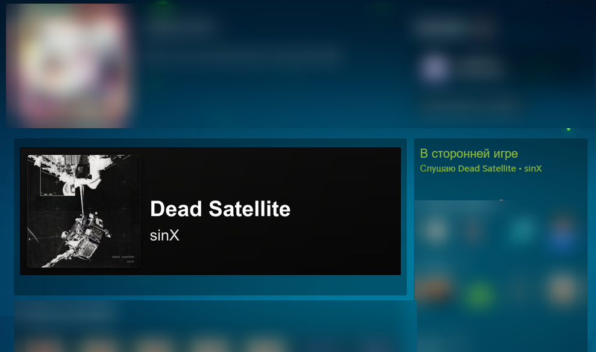

# steam-now-playing

Показывает, что ты сейчас слушаешь, в Steam: статус в профиле + карточка трека в artwork showcase.



## Как это работает

- **Статус профиля** обновляется при смене трека и сбрасывается на паузе
- **Витрина-карточка** (экспериментально): бот рисует карточку (обложка, название, артист, альбом), заливает в «Иллюстрации» и привязывает к витрине. Три ориентации: обычная 630×800, `wide` 2400×800 (растяжка по ширине витрины), `vertical` 630×1200 (по высоте)
- **Обложки**: last.fm → iTunes → Cover Art Archive → своя `DEFAULT_COVER` → градиент
- **Кэш** обложек и карточек в `cache/` — повторные треки не скачиваются и не рендерятся
- Чистятся только арты бота (невидимая zero-width подпись), личные иллюстрации не трогаются
- Хот-релоад `.env` без перезапуска; языки ru/en

## Требования

- Windows (бот кроссплатформенный, но лончеры под cmd)
- Node.js 18+ — если нет, `start-bot.bat` предложит скачать portable LTS в папку `node`
- Аккаунт last.fm или stats.fm со скробблером — иначе боту неоткуда взять трек

## Быстрый старт

1. Запусти **`start-bot.bat`** — он проверит Node/npm/зависимости, создаст `.env` и откроет меню
2. В настройках меню впиши ники last.fm / stats.fm (Enter пропускает любой вопрос)
3. Войди в Steam: QR-код, логин-пароль или сохранённый токен (`tokens.json`)

Дальше бот работает сам: меняется трек — меняется статус и карточка.

## Команды

```bash
node src/index.js                  # основной режим
node src/index.js --once           # один цикл проверки и выход (для планировщика)
node src/index.js --check-sources  # что сейчас играет (JSON)
node src/index.js --check-updates  # проверить обновления, не обновляя
node src/index.js --update         # обновиться до последней версии
node src/index.js --showcase-test  # залить карточку текущего трека и выйти
```

Ещё есть `--showcase-slot`, `--dump-showcases`, `--status-test` — разовые утилиты витрины и статуса.

## Обновление

Бот сверяется с **GitHub Releases** при старте и раз в 6 часов. `--update` работает в двух режимах: git-копия — `git pull` (+ `npm install` при изменении зависимостей); ZIP-копия (без git) — скачивает релиз и заменяет файлы, сохраняя `.env`, `tokens.json`, `cache/`, `node_modules`. Сетевые запросы идут через `UPDATE_PROXY` (по умолчанию — `LASTFM_PROXY`).

Коммиты без релиза обновления не создают:

```bash
git push
gh release create vX.Y.Z --target master --title "vX.Y.Z" --notes "что нового"
```

## Регистрация на сервисах

Приоритет источников: **stats.fm → last.fm**, нужен хотя бы один. Без регистрации и скробблера боту неоткуда брать трек.

**stats.fm** — [app.stats.fm](https://app.stats.fm): Sign up через email или Google. Ник виден в адресе профиля `app.stats.fm/ник`. В настройках профиля (Sources) подключи Spotify — в один клик. Без подписки stats.fm синхронизирует только Spotify: если слушаешь не в нём, подключи last.fm-скробблер.

**last.fm** — [last.fm/join](https://www.last.fm/join): email, ник, пароль (можно через мобильное приложение). Ник виден в адресе профиля `last.fm/user/ник`. Подключи скробблер — то, что играет, в last.fm сообщают внешние сервисы: YouTube Music / Spotify / Яндекс Музыка через браузерное расширение, на телефоне — Pano Scrobbler или похожий. Свой API key не обязателен (встроен в бота); свой на случай лимитов: [last.fm/api/account/create](https://www.last.fm/api/account/create) → `LASTFM_API_KEY`.

Ники впиши в `.env` (или в настройках меню) — хот-релоад подхватит без перезапуска:

```env
LASTFM_USERNAME=твой_ник
STATSFM_USERNAME=твой_ник
```

## Настройка

Всё — в `.env` (создаётся из `.env.example`, внутри комментарии к каждому параметру). Главное:

- `LASTFM_USERNAME` / `STATSFM_USERNAME` — хотя бы один источник
- `SHOWCASE_ENABLED`, `SHOWCASE_TYPE` (22 = избранная иллюстрация, 13 = сетка 2×2), `SHOWCASE_STRETCH` (wide / vertical / none), `SHOWCASE_SLOT` — витрина должна быть добавлена на профиле заранее
- `SHOWCASE_DEDUP` (track — карточка на каждый трек, album — реже заливок), `SHOWCASE_CLEAR_ON_EXIT`, `SHOWCASE_MIN_INTERVAL_MS`
- `POLL_INTERVAL_MS`, `STATUS_TEMPLATE` ({title} / {artist} / {album} / {source}), `LANG=ru|en`
- Прокси для заблокированных регионов: `LASTFM_PROXY` (только last.fm), `UPDATE_PROXY` (GitHub)
- Steam-креды опциональны: без них вход по QR-коду; `STEAM_SHARED_SECRET` из SDA — код 2FA генерится сам

Смена ориентации или размеров карточки (`CARD_WIDTH`/`CARD_HEIGHT`) меняет ключ кэша — карточки перерисуются и перезальются, старые подчистятся.

## Если что-то не так

| В логе | Что это значит |
|---|---|
| `Ошибка: HTTP 429` | Steam лимитирует edit-эндпоинты — бот ретраит; подними `SHOWCASE_MIN_INTERVAL_MS` |
| `Витрина иллюстраций не найдена` | Витрины нет на профиле или не тот номер в `SHOWCASE_SLOT` |
| `Профиль … не найден (404)` | Неверный ник stats.fm — источник отключится до перезапуска |
| `обложка не скачалась` | Обложки нет нигде — задай `DEFAULT_COVER` (путь или URL) |
| `Ничего не играет` | Скробблер не передаёт трек — проверь подключение к источнику |
| `Не удалось проверить обновления` | Нет доступа к GitHub — укажи `UPDATE_PROXY` |
| `Бот уже запущен` | Работает второй экземпляр; два бота воюют за сессию Steam |
| `DeprecationWarning: util.isArray` | Безвредно, предупреждение заглушено |

## Структура

```
src/
  config.js     — читает .env, хот-релоад
  i18n.js       — строки ru/en
  first-run.js  — мастер первого запуска (язык, ники, витрина)
  sources.js    — stats.fm + last.fm → единый track object, обложки
  steam.js      — вход (QR/пароль/токен), steam-user, статус
  card.js       — генерация карточки (@napi-rs/canvas), три макета
  showcase.js   — заливка в artwork showcase, витрина, чистка
  updater.js    — проверка и установка обновлений (git / ZIP)
  index.js      — главный цикл
docs/
  menu-ru.txt / menu-en.txt — тексты меню лончера
  install-help.txt, npm-failed.txt, node-missing.txt — подсказки для батников
```

## Риски

- `tokens.json` и `steam-qr.png` содержат данные сессии — не коммить их
- Эндпоинты Steam комьюнити недокументированы — режим best-effort
- Частые логины с одного IP могут триггерить лимиты Steam — используй `STEAM_SHARED_SECRET`
